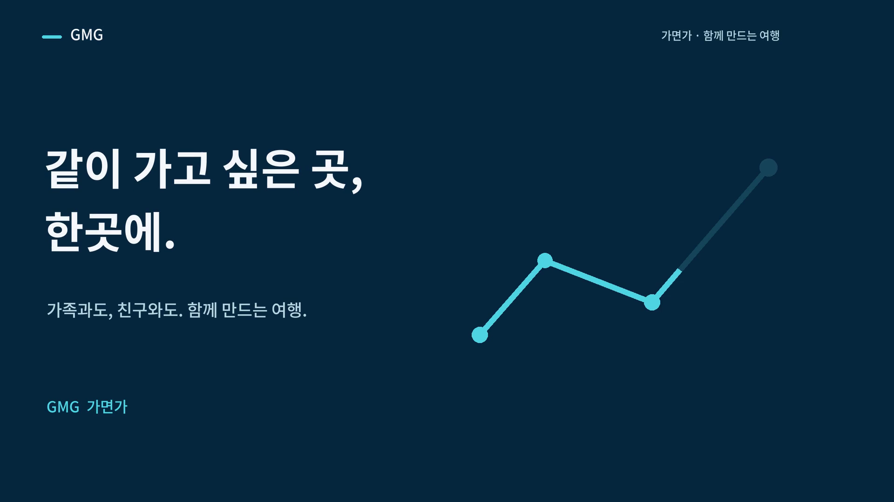

# GMG 대표 홍보 영상

[GMG 대표 영상 재생](GMG-launch-film.mp4)

가족이나 친구와 가고 싶은 곳을 모으고, 차량에서 코스를 고르는 GMG의 이용 흐름을 1분으로 소개합니다. 타이포그래피와 경로 애니메이션, 실제 앱 조작 녹화를 함께 편집한 프로젝트 홍보 영상입니다. 실제 출시를 알리는 광고는 아닙니다.

2026년 11월 12일 수정본은 Noto Sans KR 자막, 큰 휴대폰 화면, 구간별 배경음 변화와 전환 효과음을 반영했습니다.

## 이번에 수정한 부분

- 설명 자막을 Noto Sans KR로 통일하고 제목과 본문의 굵기를 구분했습니다. 큰 크기로 렌더링한 글씨를 축소해 가장자리를 다듬었습니다.
- 보조 설명과 하단 문구를 키우고, 긴 문장은 두 줄로 정리했습니다.
- 작게 놓여 있던 휴대폰 화면을 크게 보여준 뒤 차량 화면으로 전환합니다.
- 시연 구간에 리듬을 더하고 후반부의 강도를 낮췄습니다. 효과음 구간에는 배경음을 낮춰 소리가 겹치는 것을 줄였습니다.

## 효과음 목록

| 종류 | 횟수 | 시작 시점 초 |
| --- | ---: | --- |
| 좌우로 이동하는 전환음 슉 | 8 | 4.78, 10.78, 14.02, 18.78, 26.78, 37.78, 45.78, 52.78 |
| 부드러운 강조음 | 7 | 5.45, 5.80, 6.15, 20.10, 29.20, 32.40, 39.10 |
| 엔딩 3음 | 3 | 53.45, 53.65, 53.85 |

모두 영상 편집용 효과음입니다. 앱 자체의 효과음이 재생되는 것을 시연한 것은 아닙니다.

## 구성

| 시간 | 내용 |
| --- | --- |
| 0:00 | 같이 가고 싶은 곳, 한곳에 |
| 0:05 | 각자 찾은 장소가 하나의 코스로 |
| 0:11 | 휴대폰에서 찾고, 차량에서 함께 |
| 0:19 | 주차도 미리 살펴봐요 |
| 0:27 | 이동시간·이동거리·예상비용으로 코스 비교 |
| 0:38 | 다시 켜도 이어지는 코스 |
| 0:46 | 분할 화면과 다크 모드 |
| 0:53 | 함께 고른 곳으로 GMG |

## 제작 범위

- 1920×1080, 30fps, H.264 MP4, AAC 스테레오 오디오.
- 경로 선과 타이포그래피는 이 영상을 위해 만든 모션 그래픽입니다. 경로 선은 설명용 도식이며 실제 지도 경로가 아닙니다.
- 차량 앱은 Pleos Connect 에뮬레이터의 실제 조작 녹화이며, 휴대폰 화면은 실제 웹 화면 캡처입니다.
- 배경음과 효과음은 이 영상을 위해 코드로 합성했습니다. 외부 음원·샘플·나레이션은 사용하지 않았습니다.
- 주차요금은 조건에 따른 예상 금액이고, 관람료는 시연용 입력값입니다. 미확인 요금은 별도로 표시합니다.
- AI 자동 최적화, 자동 도착 감지 또는 실제 도로 주행을 시연하는 영상은 아닙니다.

기존 [프로젝트 소개](GMG-overview.mp4)와 [상세 기능 시연](GMG-walkthrough.mp4)은 별도 자료로 유지합니다.

## 검수 결과

| 회차 | 확인 내용 | 결과 |
| --- | --- | --- |
| 1차 | 자막 문자 174종, 글자 크기 10종의 글리프 확인. 자막 47개 행의 배치 및 완성본의 설명 영역 대조. 큰 휴대폰 화면과 960×540 축소 화면 확인 | 누락 글리프·설명 자막 영역 초과 없음. 검사한 설명 영역의 픽셀 일치율 99.99% 이상 |
| 2차 | 전체 1,800프레임과 오디오 디코딩, 0.5초 간격 120개 화면 샘플, 효과음 18개의 배치·스테레오 전환음 확인, 음량 측정 | 디코딩 오류·클리핑·중간의 의도치 않은 무음 없음. 통합 음량 −17.83 LUFS, 최대 트루 피크 −3.43 dBTP |
| 3차 | GitHub 공개 파일 재다운로드, SHA-256 비교, 전체 영상·오디오 디코딩, 기획서에 사용한 공개 영상 URL 확인 | 배포 후 확인 |

SHA-256: `be46f5ce7cb238bc5da9797567d79797593ab4061dd0894d8604bf71a83c891e`.

검수 범위는 위 항목이며, 모든 기기·플레이어에서의 재생을 보장하는 검사는 아닙니다.
